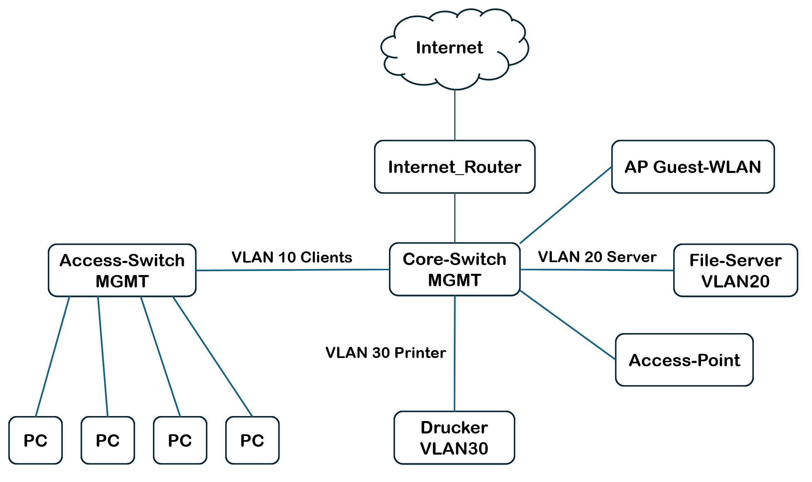
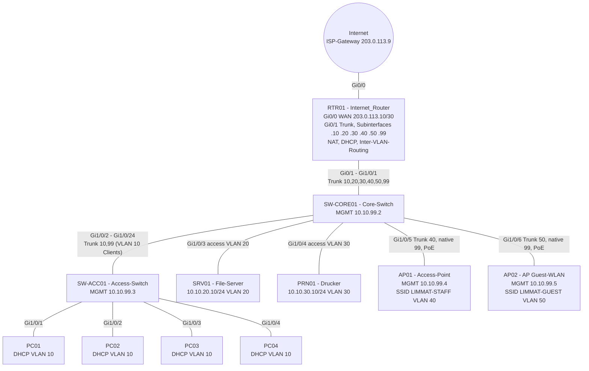

# Auftrag 3 - Netzwerkdokumentation erstellen

**Modul:** M129, Unterrichtsblock 7
**Datum:** 19.10.2026

## Ausgangslage



Vorgegeben sind: Internet, Internet_Router, Core-Switch (MGMT), Access-Switch (MGMT) mit vier PCs, File-Server (VLAN 20), Drucker (VLAN 30), Access-Point, AP Guest-WLAN und die VLANs 10 (Clients), 20 (Server) und 30 (Printer). Alle fehlenden Angaben habe ich laut Auftrag durch realistische Werte ergänzt. Als Firma habe ich ein fiktives Treuhandbüro mit 15 Mitarbeitenden angenommen.

---

# Netzwerkdokumentation "Limmat Treuhand GmbH"

| | |
|---|---|
| **Firma** | Limmat Treuhand GmbH (fiktiv), Bürostandort Zürich, 15 Mitarbeitende |
| **Version** | 1.0 |
| **Stand** | 19.10.2026 |
| **Verfasser** | Yann Kobler |
| **Zugangsdaten** | nicht in diesem Dokument, siehe Passwortmanager (KeePass), Ordner "Netzwerk" |

## 1. Netzwerkschema

### 1.1 Logisches Schema



### 1.2 Netze und VLANs

| VLAN | Name | Netz | Gateway (RTR01) | Zweck |
|---|---|---|---|---|
| 10 | CLIENTS | 10.10.10.0/24 | 10.10.10.1 | kabelgebundene Arbeitsplätze |
| 20 | SERVER | 10.10.20.0/24 | 10.10.20.1 | File-Server, interne Dienste |
| 30 | PRINTER | 10.10.30.0/24 | 10.10.30.1 | Drucker und Multifunktionsgeräte |
| 40 | WLAN-STAFF | 10.10.40.0/24 | 10.10.40.1 | WLAN für Mitarbeitende (Laptops, Smartphones) |
| 50 | WLAN-GUEST | 10.10.50.0/24 | 10.10.50.1 | Gäste-WLAN, nur Internet |
| 99 | MGMT | 10.10.99.0/24 | 10.10.99.1 | Verwaltung der Netzwerkgeräte |
| - | WAN | 203.0.113.8/30 | 203.0.113.9 (ISP) | Transfernetz zum Provider |

Hinweis: 203.0.113.0/24 ist ein Dokumentationsbereich. In der echten Dokumentation steht hier die statische öffentliche IP aus dem Providervertrag.

### 1.3 Physische Verkabelung

| Von Gerät | Port | Nach Gerät | Port | Kabel | Modus |
|---|---|---|---|---|---|
| RTR01 | Gi0/0 | Glasfaser-Modem ISP | LAN1 | Cat6, 1 m | WAN |
| RTR01 | Gi0/1 | SW-CORE01 | Gi1/0/1 | Cat6, 1 m | Trunk 10,20,30,40,50,99 |
| SW-CORE01 | Gi1/0/2 | SW-ACC01 | Gi1/0/24 | Cat6, 15 m (Steigzone) | Trunk 10,99 |
| SW-CORE01 | Gi1/0/3 | SRV01 | NIC1 | Cat6, 2 m | access VLAN 20 |
| SW-CORE01 | Gi1/0/4 | PRN01 | LAN | Dose D-04 | access VLAN 30 |
| SW-CORE01 | Gi1/0/5 | AP01 | ETH0 (PoE) | Dose D-05 (Decke Büro) | Trunk 40, native 99 |
| SW-CORE01 | Gi1/0/6 | AP02 | ETH0 (PoE) | Dose D-06 (Decke Empfang) | Trunk 50, native 99 |
| SW-ACC01 | Gi1/0/1-4 | PC01-PC04 | NIC | Dosen D-11 bis D-14 | access VLAN 10 |

Alle Geräte ausser den Access-Points stehen im 19-Zoll-Rack im Technikraum (Raum 0.05). Freie Ports: SW-CORE01 Gi1/0/7-24, SW-ACC01 Gi1/0/5-23.

## 2. Inventar

| Gerät | Rolle | Typ / Modell | Standort | Seriennummer | Firmware | Garantie bis |
|---|---|---|---|---|---|---|
| RTR01 | Internet_Router, NAT, DHCP, Inter-VLAN-Routing | Cisco ISR 1111-4P | Rack 1, HE 1 | FGL2531A1B2 | IOS-XE 17.9 | 31.12.2028 |
| SW-CORE01 | Core-Switch, PoE für APs | Cisco Catalyst 9200L-24P-4G | Rack 1, HE 3 | JAE25210ABC | IOS-XE 17.9 | 31.12.2028 |
| SW-ACC01 | Access-Switch für Arbeitsplätze | Cisco Catalyst 9200L-24T-4G | Rack 1, HE 4 | JAE25210ABD | IOS-XE 17.9 | 31.12.2028 |
| AP01 | Access-Point Mitarbeitende | Cisco Catalyst 9105AXI | Decke Grossraumbüro | FJC2532X01 | 17.9 | 31.12.2028 |
| AP02 | Access-Point Gäste | Cisco Catalyst 9105AXI | Decke Empfang | FJC2532X02 | 17.9 | 31.12.2028 |
| SRV01 | File-Server, interner DNS | Dell PowerEdge T350, Windows Server 2022 | Rack 1, Tower-Ablage | 7XK2Q13 | - | 30.06.2029 |
| PRN01 | Multifunktionsdrucker | HP Color LaserJet Pro MFP 4302fdw | Kopierraum 1.02 | CNB1R2X3Y4 | 2.8 | 30.06.2027 |
| PC01-PC04 | Arbeitsplätze Buchhaltung | HP EliteDesk 800 G9, Windows 11 Pro | Büro 1.01 | siehe Asset-Liste | - | 30.06.2029 |
| Modem ISP | Glasfaser-Abschluss | vom Provider (Swisscom Business) | Rack 1 | - | vom Provider | Mietgerät |

**Provider:** Swisscom Business Internet, 1 Gbit/s symmetrisch, Vertragsnummer im Ordner "Verträge", Störungsnummer 0800 xxx xxx.

## 3. IP-Adressplan

### 3.1 Statische Adressen

| Gerät | Interface | IP-Adresse | VLAN |
|---|---|---|---|
| RTR01 | Gi0/0 | 203.0.113.10/30 | WAN |
| RTR01 | Gi0/1.10 | 10.10.10.1/24 | 10 |
| RTR01 | Gi0/1.20 | 10.10.20.1/24 | 20 |
| RTR01 | Gi0/1.30 | 10.10.30.1/24 | 30 |
| RTR01 | Gi0/1.40 | 10.10.40.1/24 | 40 |
| RTR01 | Gi0/1.50 | 10.10.50.1/24 | 50 |
| RTR01 | Gi0/1.99 | 10.10.99.1/24 | 99 |
| SW-CORE01 | Vlan99 | 10.10.99.2/24 | 99 |
| SW-ACC01 | Vlan99 | 10.10.99.3/24 | 99 |
| AP01 | Management | 10.10.99.4/24 | 99 |
| AP02 | Management | 10.10.99.5/24 | 99 |
| SRV01 | NIC1 | 10.10.20.10/24 | 20 |
| PRN01 | LAN | 10.10.30.10/24 | 30 |

### 3.2 Adressbereiche pro Netz

| Netz | Netzwerkinfrastruktur | Statisch (Server, Geräte) | DHCP-Pool | Reserve |
|---|---|---|---|---|
| 10.10.10.0/24 Clients | .1 | .2 - .49 (Reserve für statische Clients) | .100 - .200 | .50 - .99, .201 - .254 |
| 10.10.20.0/24 Server | .1 | .10 - .49 | kein DHCP | .50 - .254 |
| 10.10.30.0/24 Printer | .1 | .10 - .49 | kein DHCP | .50 - .254 |
| 10.10.40.0/24 WLAN-Staff | .1 | - | .100 - .250 | .2 - .99 |
| 10.10.50.0/24 WLAN-Guest | .1 | - | .100 - .250, Lease 4 h | .2 - .99 |
| 10.10.99.0/24 MGMT | .1 - .9 | .10 - .49 | kein DHCP | .50 - .254 |

DNS für interne Netze: 10.10.20.10 (SRV01), Weiterleitung an den Provider-DNS. Gäste erhalten direkt einen öffentlichen DNS (9.9.9.9).

## 4. Konfigurationsinformationen

### RTR01 (Internet_Router)

```text
Hostname:        RTR01
Gi0/0:           WAN, 203.0.113.10/30, ip nat outside
Gi0/1:           Trunk zum Core-Switch, ohne IP
Gi0/1.10/.20/.30/.40/.50/.99:  encapsulation dot1Q <VLAN>, ip nat inside
Default-Route:   ip route 0.0.0.0 0.0.0.0 203.0.113.9
NAT:             PAT (overload) auf Gi0/0 für alle internen Netze
DHCP-Pools:      CLIENTS (VLAN 10), WLAN-STAFF (VLAN 40), WLAN-GUEST (VLAN 50)
ACL GUEST-IN:    auf Gi0/1.50, verbietet 10.10.0.0/16, erlaubt Internet
ACL MGMT-IN:     Zugriff auf 10.10.99.0/24 nur aus VLAN 10, Adressen .2 - .49 (Admin-PC)
Zugriff:         nur SSH v2, Telnet deaktiviert
```

### SW-CORE01 (Core-Switch)

```text
Hostname:        SW-CORE01
VLANs:           10 CLIENTS, 20 SERVER, 30 PRINTER, 40 WLAN-STAFF, 50 WLAN-GUEST, 99 MGMT
Management-IP:   Vlan99 10.10.99.2/24, ip default-gateway 10.10.99.1
Gi1/0/1:         Trunk zu RTR01, allowed 10,20,30,40,50,99
Gi1/0/2:         Trunk zu SW-ACC01, allowed 10,99
Gi1/0/3:         access VLAN 20 (SRV01)
Gi1/0/4:         access VLAN 30 (PRN01)
Gi1/0/5:         Trunk zu AP01, native VLAN 99, allowed 40,99, PoE
Gi1/0/6:         Trunk zu AP02, native VLAN 99, allowed 50,99, PoE
Gi1/0/7-24:      shutdown, VLAN 999 (unbenutzt)
Spanning Tree:   Rapid-PVST, Root Bridge (Priorität 4096)
```

### SW-ACC01 (Access-Switch)

```text
Hostname:        SW-ACC01
VLANs:           10 CLIENTS, 99 MGMT
Management-IP:   Vlan99 10.10.99.3/24, ip default-gateway 10.10.99.1
Gi1/0/1-4:       access VLAN 10, spanning-tree portfast, bpduguard
Gi1/0/5-23:      shutdown, VLAN 999 (unbenutzt)
Gi1/0/24:        Trunk zu SW-CORE01, allowed 10,99
```

### AP01 und AP02

```text
AP01: SSID LIMMAT-STAFF, WPA3-Enterprise (Anmeldung über Benutzerkonto), VLAN 40, Kanäle 2,4 GHz: 1, 5 GHz: 36
AP02: SSID LIMMAT-GUEST, WPA2/WPA3-Personal, Passwort wechselt monatlich, VLAN 50,
      Client-Isolation aktiv, Kanäle 2,4 GHz: 11, 5 GHz: 52
```

### Konfigurations-Backup

Die Running-Configs von RTR01, SW-CORE01 und SW-ACC01 werden nach jeder Änderung und zusätzlich jeden Sonntag auf SRV01 unter `\\SRV01\IT\Netzwerk\Config-Backups\` gesichert.

## 5. Designentscheide

**Q: Warum wurden die Netze mit VLANs getrennt?**
A: Damit Clients, Server, Drucker und Gäste in getrennten Broadcast-Domänen liegen. Der Verkehr zwischen den Netzen läuft über den Router und kann dort mit ACLs gefiltert werden. Ein infizierter PC kann so nicht direkt jedes andere Gerät erreichen.

**Q: Warum hat der File-Server ein eigenes VLAN 20?**
A: Damit Server vom Client-Netz getrennt sind und der Zugriff gezielt geregelt werden kann. Später kann man z. B. festlegen, dass nur VLAN 10 und 40 auf die Freigaben zugreifen dürfen.

**Q: Warum sind die Drucker in einem eigenen VLAN 30?**
A: Drucker werden selten aktualisiert und haben oft Sicherheitslücken. Im eigenen VLAN sind sie isoliert und erreichen nur, was sie wirklich brauchen. Zudem sind sie so leicht zu finden.

**Q: Warum gibt es zwei Access-Points und ein separates VLAN 50 für Gäste?**
A: Gäste sollen nur ins Internet und auf keinen Fall ins Firmennetz. Das Gast-VLAN wird am Router mit einer ACL vom internen Netz 10.10.0.0/16 getrennt, zusätzlich ist auf AP02 die Client-Isolation aktiv. Mitarbeitende haben ein eigenes WLAN-VLAN 40, damit WLAN-Geräte getrennt von den fest installierten PCs überwacht werden können.

**Q: Warum ein eigenes Management-VLAN 99?**
A: Die Verwaltungsoberflächen der Netzwerkgeräte sollen nicht aus dem Client- oder Gästenetz erreichbar sein. Im Schema sind die Switches deshalb mit "MGMT" bezeichnet. Zugriff ist nur vom Admin-PC aus erlaubt.

**Q: Warum ist die Verbindung Core-Switch zu Access-Switch ein Trunk, obwohl im Schema nur VLAN 10 steht?**
A: Über die Leitung laufen die Daten der Clients (VLAN 10) und zusätzlich das Management des Access-Switches (VLAN 99). Deshalb ein Trunk mit genau diesen zwei erlaubten VLANs.

**Q: Warum der Bereich 10.10.0.0/16 und /24-Netze?**
A: 10.0.0.0/8 ist privat und bietet viel Platz. Viele Heimnetze nutzen 192.168.0.x oder 192.168.1.x, mit 10.10.x.x gibt es beim späteren VPN-Zugriff von zu Hause keinen Adresskonflikt. Ein /24 pro VLAN ist für 15 Mitarbeitende grosszügig, ist aber übersichtlich und lässt Platz für Wachstum. Das dritte Oktett entspricht der VLAN-Nummer (VLAN 20 = 10.10.20.0/24), so erkennt man das VLAN direkt an der IP-Adresse.

**Q: Warum macht der Router das Inter-VLAN-Routing (Router-on-a-Stick) und nicht der Core-Switch?**
A: Bei 15 Mitarbeitenden ist der Verkehr zwischen den VLANs gering, ein Gigabit-Trunk reicht. Der Router kann gleichzeitig NAT, DHCP und die ACLs übernehmen, so liegt die gesamte Regelung an einem Ort. Bei starkem Wachstum kann das Routing auf einen Layer-3-Switch verschoben werden.

**Q: Warum haben Server, Drucker und Netzwerkgeräte statische Adressen?**
A: Diese Geräte werden von anderen über ihre Adresse angesprochen (Druckerwarteschlange, Laufwerkzuordnung, Management). Eine wechselnde Adresse würde zu Störungen führen. Die statischen Bereiche liegen ausserhalb der DHCP-Pools, damit es keine Konflikte gibt.

**Q: Warum werden unbenutzte Ports abgeschaltet und in VLAN 999 gelegt?**
A: Damit niemand ein fremdes Gerät an einer freien Dose einstecken und direkt im Firmennetz arbeiten kann.

## 6. Bekannte Schwachstellen und Erweiterungen

| Punkt | Bemerkung |
|---|---|
| Single Point of Failure | RTR01 und SW-CORE01 sind einfach vorhanden. Für ein Büro dieser Grösse akzeptiert, Ersatzgerät mit Next-Business-Day-Garantie. |
| Internet | nur ein Anschluss, bei Bedarf Mobilfunk-Backup (LTE/5G) ergänzen |
| Erweiterung Arbeitsplätze | SW-ACC01 hat 19 freie Ports, VLAN 10 hat noch über 150 freie Adressen |
| USV | Rack ist an einer USV angeschlossen (Überbrückung ca. 15 Minuten) |

## 7. Änderungsprotokoll

| Datum | Version | Person | Änderung |
|---|---|---|---|
| 19.10.2026 | 1.0 | Yann Kobler | Erstellung der Dokumentation |
